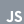

# Hi, I'm Matías Garcés

Computer Science Student | Software Developer | Creative Developer & Brand Designer

---

### About Me

I'm a 21-year-old Computer Science student from Ambato, Ecuador, who lives between two worlds: design and code. I help brands understand who they are, build their visual identity, and turn it into web experiences that people *feel*, not just visit.

- Currently pursuing my **B.S. in Computer Science (Software Engineering)** at **UEES**
- Currently working as a **Software Developer** at **Pulsotek**
- Freelance **brand designer**: brand analysis, logos, color systems and immersive landing pages
- Focused on **UX/UI, motion and creative front-end** with React, Astro and GSAP
- Inspired by art, music and editorial design

---

### Featured Projects

- **OMAKASE**: a concept web experience inspired by Álvaro Díaz's album (Astro · GSAP)
- **Proalimec**: brand identity and website for a meat distributor going digital (React · GSAP)
- **PulsoCont**: landing page for Pulsotek's accounting software (React · GSAP)

---

### Technology Stack

  &nbsp;&nbsp;&nbsp;&nbsp;
  &nbsp;&nbsp;&nbsp;&nbsp;
  &nbsp;&nbsp;&nbsp;&nbsp;
  &nbsp;&nbsp;&nbsp;&nbsp;
  &nbsp;&nbsp;&nbsp;&nbsp;
  &nbsp;&nbsp;&nbsp;&nbsp;
  &nbsp;&nbsp;&nbsp;&nbsp;
  &nbsp;&nbsp;&nbsp;&nbsp;
  &nbsp;&nbsp;&nbsp;&nbsp;
  &nbsp;&nbsp;&nbsp;&nbsp;
  &nbsp;&nbsp;&nbsp;&nbsp;
  &nbsp;&nbsp;&nbsp;&nbsp;
  &nbsp;&nbsp;&nbsp;&nbsp;
  

---

### Let's Connect

- Portfolio Website: coming soon
- LinkedIn: [linkedin.com/in/mattias-garces](https://www.linkedin.com/in/mattias-garc%C3%A9s-871231289/)
- Email: [mattygarces.vargas@gmail.com](mailto:mattygarces.vargas@gmail.com)

---

> "Design & code from the middle of the world."
